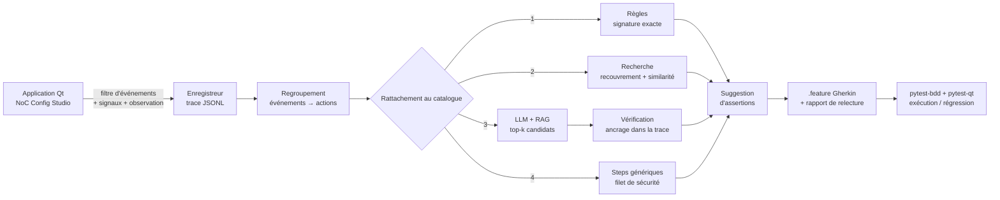

# demo2test — d'une démonstration à un test BDD automatisé

> *A tester plays a scenario live in a Qt application; demo2test records the
> interactions, abstracts them into business actions mapped onto an existing
> step catalog (rules → catalog retrieval → LLM with verification) and generates
> an executable Gherkin test — then measures what each stage really brings.*

Un testeur lance l'application et joue son scénario **à la souris et au clavier**.
demo2test capture ses interactions, les regroupe en **actions métier**, les rattache
au **catalogue de steps existant**, propose les **vérifications** à ajouter et génère
un **scénario Gherkin exécutable**, accompagné d'un rapport de relecture.

```text
52 événements bruts  ──►  8 actions d'interface  ──►  4 steps métier + 3 vérifications
(clics, frappes,          (saisie, sélection,         When I add the initiator "cpu0" using AXI
 effets observés)          clic, Entrée...)            Then the "Initiators" list contains "cpu0 (AXI)"
```

## Pourquoi ce projet

Écrire un test GUI à la main est lent ; enregistrer une macro produit des scripts
fragiles et illisibles. L'objectif est d'obtenir le test qu'un ingénieur QA aurait
écrit : au niveau **métier**, dans le **vocabulaire de l'équipe** (le catalogue de
steps), **synchronisé** sur les traitements asynchrones et **relu** avant intégration.

L'IA n'est pas utilisée « parce que c'est possible » : elle intervient seulement là
où les règles ne suffisent pas, ses propositions sont **vérifiées contre la trace**,
et son apport est **mesuré** sur un banc d'évaluation.

## Architecture



| Étape | Module | Ce qu'elle fait |
|---|---|---|
| Système sous test | `app/noc_studio.py` | Mini outil EDA : topologie, initiateurs/cibles AXI/AHB/CHI, validation, génération **asynchrone** de netlist |
| Instrumentation | `recorder/recorder.py` | Filtre d'événements sur `QApplication`, branchement des signaux de saisie, observation des effets ; rattachement par **nom accessible** ; état initial ; checkpoints (`Ctrl+Maj+K`) |
| Regroupement | `abstraction/actions.py` | 12 frappes + 2 corrections → 1 action `set` ; touche Entrée → `submit` ; clics sans effet → inertes ; effets rattachés à l'action qui les cause |
| Catalogue | `catalog.py` | **Source unique** : sert au rattachement *et* à la bibliothèque pytest-bdd (`bdd/steps.py`) |
| Rattachement | `abstraction/matching.py` | Règles → recherche (ordre libre, bruit toléré) → LLM avec candidats issus du catalogue, **réponse vérifiée** (step existant, actions cohérentes, paramètres présents dans la trace) → générique |
| Vérifications | `abstraction/assertions.py` | Depuis les checkpoints et les effets observés (listes, statut), avec le **délai observé** pour les effets asynchrones |
| Génération | `gherkin.py` | `.feature` commenté (origine et confiance de chaque step) + `review.json` (actions couvertes, actions ignorées, propositions LLM rejetées) |
| Exécution | `bdd/steps.py` | Steps pytest-bdd synchronisés par attente de condition (`waitUntil`), jamais par `sleep` fixe |

## Résultats (banc d'évaluation)

12 démonstrations enregistrées sur l'application réelle, chacune avec une difficulté
réaliste (faute de frappe, ordre de saisie différent, clics parasites, touche
Entrée, effet asynchrone...), comparées au test qu'un ingénieur QA écrirait à la main.

| Stratégie | Précision | Rappel | F1 | Scénarios exacts | Steps métier retrouvés | Tests exécutables | Appels LLM (rejetés) |
|---|---|---|---|---|---|---|---|
| `generic` (macro) | 2 % | 4 % | 3 % | 0 % | 0 % | 100 % | – |
| `rules` | 88 % | 94 % | 91 % | 75 % | 94 % | 100 % | – |
| `rules+retrieval` | 91 % | 96 % | 93 % | 83 % | 96 % | 100 % | – |
| `rules+llm` | **100 %** | **100 %** | **100 %** | **100 %** | **100 %** | 100 % | 4 (1) |
| `rules+retrieval+llm` | **100 %** | **100 %** | **100 %** | **100 %** | **100 %** | 100 % | 3 (1) |

LLM : `qwen2.5:3b` exécuté localement avec Ollama (CPU, Windows), température 0.
Détail par scénario : [`eval/RESULTS.md`](eval/RESULTS.md) (sans LLM) et
[`eval/RESULTS_llm.md`](eval/RESULTS_llm.md) (avec LLM). Ce qu'on lit dans ces chiffres :

* un enregistrement « macro » produit un test **exécutable mais inutilisable** (aucun step métier) ;
* les **règles** font l'essentiel du travail sur les parcours propres ;
* la **recherche dans le catalogue** récupère les cas bruités (clics parasites, hésitations) ;
* le **LLM** résout les deux cas qu'aucune règle ne couvre (formulaire validé avec **Entrée**
  au lieu du bouton), avec seulement **3 appels sur 12 démonstrations** : il n'intervient
  que là où les étages déterministes échouent ;
* la **vérification compte autant que le LLM** : sur `s10_late_edit`, le modèle a proposé
  « créer le projet » pour un simple changement de fréquence. La proposition a été
  **rejetée** (action obligatoire absente de la trace) et l'action est restée un step
  générique correct. Sans vérification, le test généré aurait été faux.

### Rejouer ou mesurer l'apport du LLM

```bash
# rejouer les réponses enregistrées (aucun GPU ni réseau nécessaire, résultats identiques)
python eval/run_eval.py --llm replay:eval/llm_cache.json

# remesurer avec un modèle local
ollama pull qwen2.5:3b
python eval/run_eval.py --llm ollama:qwen2.5:3b --record-llm eval/llm_cache.json
```

Les réponses du LLM sont enregistrées (`eval/llm_cache.json`) : le banc enregistré sous
Windows a été rejoué à l'identique sous Linux. Une API compatible OpenAI est aussi utilisable
(`--llm openai:<modèle>`).

## Démarrage

```bash
pip install -e ".[dev]"

# 1. enregistrer une démonstration (fermer la fenêtre pour arrêter, Ctrl+Maj+K = checkpoint)
demo2test record demo.jsonl

# 2. générer le test
demo2test generate demo.jsonl -n "Configure a NoC" -o features/
demo2test generate demo.jsonl -n "Configure a NoC" --llm ollama:qwen2.5:3b

# 3. l'exécuter contre l'application
demo2test run features/

# tests du projet + banc d'évaluation
pytest -q
python eval/run_eval.py
```

Exemples générés : [`examples/`](examples/) (scénario, rapport de relecture, trace brute).

## Choix de conception

* **Identification des widgets par nom accessible.** Le même identifiant sert à
  l'enregistrement, au Gherkin et à l'exécution ; c'est aussi un levier
  d'accessibilité pour l'application testée.
* **Catalogue comme source unique de vérité.** Un step proposé existe forcément dans
  la bibliothèque exécutable (test `test_every_catalog_step_is_implemented`).
* **LLM encadré.** Candidats limités aux *k* steps les plus pertinents du catalogue (RAG),
  température 0, sortie JSON, puis vérification : step candidat, actions couvertes
  cohérentes avec la signature, chaque valeur de paramètre retrouvée dans la trace.
  Une proposition invérifiable est rejetée et tracée dans le rapport, jamais acceptée
  « par confiance ». En cas d'erreur du LLM, la chaîne se replie sur les autres étages.
* **Synchronisation par condition.** Les assertions attendent l'état attendu ; le délai
  observé pendant la démonstration est conservé comme indication.
* **Le test généré doit pouvoir échouer.** `test_generated_test_detects_a_regression`
  modifie le comportement attendu et vérifie que le test généré le détecte.

## Limites et suites

* Le jeu d'évaluation (12 démonstrations) est petit et a été conçu en même temps que
  l'outil : les 100 % mesurés ici montrent que la chaîne fonctionne, pas qu'elle
  généraliserait telle quelle à une application industrielle. L'étape suivante serait
  un jeu de démonstrations enregistrées par d'autres testeurs, sur une autre application.
* Le regroupement en actions est à base de règles ; un modèle de segmentation appris
  serait l'étape suivante pour des applications plus riches (menus, glisser-déposer, canvas).
* Les assertions proposées couvrent le statut et les listes ; les rendre configurables
  par l'équipe (quels widgets vérifier, à quel moment) faciliterait l'adoption.
* Intégration dans une chaîne de régression existante : la CI fournie exécute déjà les
  tests, le banc d'évaluation et publie les scénarios générés comme artefacts.

---
Python 3.10+ · PySide6 (Qt 6) · pytest · pytest-qt · pytest-bdd · Ollama / API compatible OpenAI · GitHub Actions
