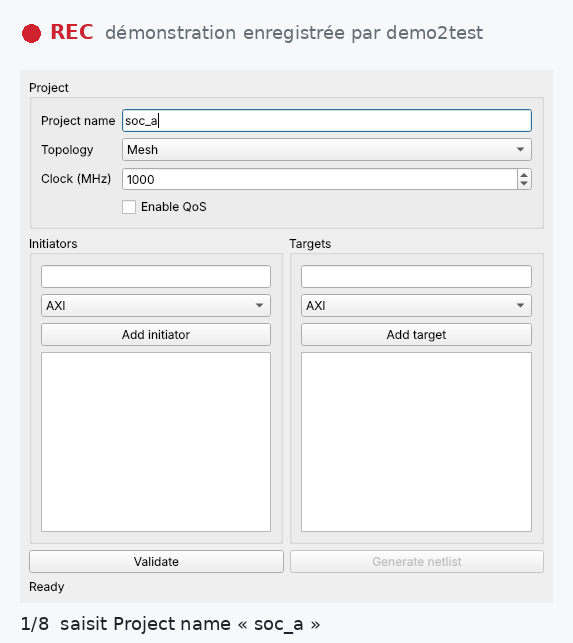
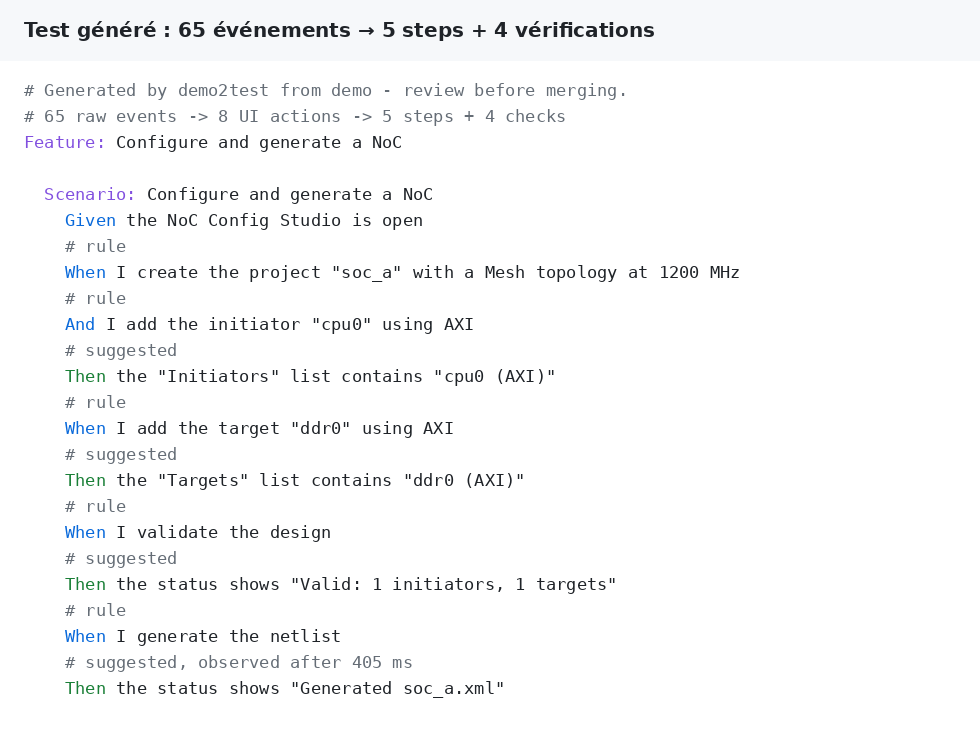
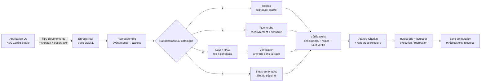

# demo2test — d'une démonstration à un test BDD automatisé

> *A tester plays a scenario live in a Qt application; demo2test records the
> interactions, abstracts them into business actions mapped onto an existing
> step catalog (rules → catalog retrieval → LLM with verification) and generates
> an executable Gherkin test — then measures what each stage really brings.*

Un testeur lance l'application et joue son scénario **à la souris et au clavier**.
demo2test capture ses interactions, les regroupe en **actions métier**, les rattache
au **catalogue de steps existant**, propose les **vérifications** à ajouter et génère
un **scénario Gherkin exécutable**, accompagné d'un rapport de relecture.

<p align="center">
  
  &nbsp;
  
</p>

*À gauche : une démonstration rejouée sur l'application pendant que l'enregistreur tourne.
À droite : le test réellement généré à partir de cette trace (65 événements → 5 steps métier
+ 4 vérifications), puis exécuté avec succès. Images produites par `docs/make_visuals.py`.*

## Pourquoi ce projet

Écrire un test GUI à la main est lent ; enregistrer une macro produit des scripts
fragiles et illisibles. L'objectif est d'obtenir le test qu'un ingénieur QA aurait
écrit : au niveau **métier**, dans le **vocabulaire de l'équipe** (le catalogue de
steps), **synchronisé** sur les traitements asynchrones et **relu** avant intégration.

L'IA n'est pas utilisée « parce que c'est possible » : elle intervient seulement là
où les règles ne suffisent pas, ses propositions sont **vérifiées contre la trace**,
et son apport est **mesuré** sur un banc d'évaluation.

## Architecture



| Étape | Module | Ce qu'elle fait |
|---|---|---|
| Système sous test | `app/noc_studio.py` | Mini outil EDA : topologie, initiateurs/cibles AXI/AHB/CHI, validation, génération **asynchrone** de netlist |
| Instrumentation | `recorder/recorder.py` | Filtre d'événements sur `QApplication`, branchement des signaux de saisie, observation des effets ; rattachement par **nom accessible** ; état initial ; checkpoints (`Ctrl+Maj+K`) |
| Regroupement | `abstraction/actions.py` | 12 frappes + 2 corrections → 1 action `set` ; touche Entrée → `submit` ; clics sans effet → inertes ; effets rattachés à l'action qui les cause |
| Catalogue | `catalog_import.py` | **Lu dans la bibliothèque pytest-bdd elle-même** (analyse AST) : motifs, descriptions, et ligne `d2t:` facultative décrivant les actions regroupées. La bibliothèque d'une autre équipe s'importe avec `--steps` |
| Rattachement | `abstraction/matching.py` | Règles → recherche (ordre libre, bruit toléré) → LLM avec candidats issus du catalogue, **réponse vérifiée** (step existant, actions cohérentes, paramètres présents dans la trace) → générique |
| Vérifications | `abstraction/assertions.py` | Depuis les checkpoints, par règles sur les effets observés, et **par le LLM** (proposition vérifiée contre l'état réellement observé) ; **délai observé** conservé pour les effets asynchrones |
| Mutants | `bdd/mutants.py` | 9 régressions réalistes injectées dans l'application pour mesurer si les tests générés les détectent |
| Génération | `gherkin.py` | `.feature` commenté (origine et confiance de chaque step) + `review.json` (actions couvertes, actions ignorées, propositions LLM rejetées) |
| Exécution | `bdd/steps.py` | Steps pytest-bdd synchronisés par attente de condition (`waitUntil`), jamais par `sleep` fixe |

## Résultats (banc d'évaluation)

12 démonstrations enregistrées sur l'application réelle, chacune avec une difficulté
réaliste (faute de frappe, ordre de saisie différent, clics parasites, touche
Entrée, effet asynchrone...), comparées au test qu'un ingénieur QA écrirait à la main.

| Stratégie | Précision | Rappel | F1 | Scénarios exacts | Steps métier retrouvés | Tests exécutables | Appels LLM (rejetés) |
|---|---|---|---|---|---|---|---|
| `generic` (macro) | 2 % | 4 % | 3 % | 0 % | 0 % | 100 % | – |
| `rules` | 88 % | 94 % | 91 % | 75 % | 94 % | 100 % | – |
| `rules+retrieval` | 91 % | 96 % | 93 % | 83 % | 96 % | 100 % | – |
| `rules+llm` | **100 %** | **100 %** | **100 %** | **100 %** | **100 %** | 100 % | 4 (1) |
| `rules+retrieval+llm` | **100 %** | **100 %** | **100 %** | **100 %** | **100 %** | 100 % | 3 (1) |

LLM : `qwen2.5:3b` exécuté localement avec Ollama (CPU, Windows), température 0.
Détail par scénario : [`eval/RESULTS.md`](eval/RESULTS.md) (sans LLM) et
[`eval/RESULTS_llm.md`](eval/RESULTS_llm.md) (avec LLM). Ce qu'on lit dans ces chiffres :

* un enregistrement « macro » produit un test **exécutable mais inutilisable** (aucun step métier) ;
* les **règles** font l'essentiel du travail sur les parcours propres ;
* la **recherche dans le catalogue** récupère les cas bruités (clics parasites, hésitations) ;
* le **LLM** résout les deux cas qu'aucune règle ne couvre (formulaire validé avec **Entrée**
  au lieu du bouton), avec seulement **3 appels sur 12 démonstrations** : il n'intervient
  que là où les étages déterministes échouent ;
* la **vérification compte autant que le LLM** : sur `s10_late_edit`, le modèle a proposé
  « créer le projet » pour un simple changement de fréquence. La proposition a été
  **rejetée** (action obligatoire absente de la trace) et l'action est restée un step
  générique correct. Sans vérification, le test généré aurait été faux.

### Les vérifications générées détectent-elles de vraies régressions ? (banc de mutation)

Un test généré qui passe toujours ne protège de rien. Les 12 scénarios générés sont donc
exécutés contre l'application intacte puis contre **9 versions défectueuses** (une
régression réaliste chacune : règle métier désactivée, mauvais message, génération qui ne
se termine pas, bouton qui reste grisé...). Un mutant est *tué* si un scénario fiable
échoue ; un scénario qui échoue déjà sur l'application intacte est une **fausse alerte**
et ne compte pas.

| Vérifications | Checks générés | Fausses alertes | Régressions détectées |
|---|---|---|---|
| aucune (actions seules) | 0 | 0 | 1/9 (11 %) |
| règles sur les effets observés | 44 | 0 | **8/9 (89 %)** |
| LLM **sans** vérification | 34 | **6 scénarios sur 12** | 2/9 (22 %) |
| LLM avec vérification | 23 (12 propositions rejetées) | 0 | 7/9 (78 %) |
| règles + LLM vérifié | 48 | 0 | **8/9 (89 %)** |

Détail par mutant : [`eval/MUTATION_llm.md`](eval/MUTATION_llm.md). Lecture honnête :

* **sans vérifications, le test généré ne sert presque à rien** (1 régression sur 9) :
  la suggestion d'assertions est indispensable ;
* **12 des 35 vérifications proposées par le LLM étaient fausses** (valeur attendue
  différente de ce qui s'est réellement affiché). Acceptées telles quelles, elles font
  échouer la moitié des tests sur l'application *intacte* : un score de mutation brut
  aurait même affiché 100 %, puisque des tests qui échouent toujours « détectent » tout ;
* avec la vérification contre l'état observé, **zéro fausse alerte** ;
* sur ce banc, **le LLM n'apporte pas de gain** par rapport aux règles (8/9 dans les deux
  cas) ; la régression restante (message de confirmation supprimé) n'est couverte par
  aucune configuration de façon stable. Une exécution antérieure, sur une version
  intermédiaire des tests générés, l'avait détectée : l'apport du LLM est réel mais
  **instable**, ce qui justifie de le garder comme complément vérifié, pas comme source
  principale.

### Validation sur des démonstrations enregistrées à la main

Pour vérifier que ces chiffres ne viennent pas d'un jeu de test fait sur mesure, trois
démonstrations ont été **enregistrées à la main par une autre personne**, à partir de
consignes écrites et sans connaître le fonctionnement interne de l'outil
(`eval/user_traces/`, consignes dans `eval/scenarios.py`).

| Stratégie | Précision | Rappel | Scénarios exacts | Steps métier retrouvés | Tests exécutables |
|---|---|---|---|---|---|
| `rules` | 65 % | 83 % | 33 % | 82 % | 100 % |
| `rules+retrieval` | 76 % | 89 % | 67 % | 88 % | 100 % |
| `rules+retrieval+llm` | **100 %** | **100 %** | **100 %** | **100 %** | 100 % |

**Ce jeu indépendant a révélé deux défauts**, corrigés depuis (tests de non-régression
`test_abandoned_edit_is_ignored` et `test_llm_proposal_is_trimmed_not_rejected_when_it_overreaches`) :

* le testeur a tapé une valeur dans le mauvais champ puis l'a effacée : ces saisies sans
  effet produisaient un step « saisir une valeur vide » qui faisait échouer le test
  généré. Une saisie abandonnée (remise à sa valeur de départ sans avoir servi) est
  désormais ignorée ;
* le LLM proposait la bonne réponse mais y incluait une action sans rapport ; la
  vérification rejetait tout. Elle retire maintenant les actions invalides et vérifie le
  reste (signature, ancrage des paramètres) au lieu de jeter une proposition correcte.

### Rejouer ou mesurer l'apport du LLM

```bash
# rejouer les réponses enregistrées (aucun GPU ni réseau nécessaire, résultats identiques)
python eval/run_eval.py --llm replay:eval/llm_cache.json

# remesurer avec un modèle local
ollama pull qwen2.5:3b
python eval/run_eval.py --llm ollama:qwen2.5:3b --record-llm eval/llm_cache.json
```

Les réponses du LLM sont enregistrées (`eval/llm_cache.json`) : le banc enregistré sous
Windows a été rejoué à l'identique sous Linux. Une API compatible OpenAI est aussi utilisable
(`--llm openai:<modèle>`).

## Démarrage

```bash
pip install -e ".[dev]"

# 1. enregistrer une démonstration (fermer la fenêtre pour arrêter, Ctrl+Maj+K = checkpoint)
demo2test record demo.jsonl

# 2. générer le test
demo2test generate demo.jsonl -n "Configure a NoC" -o features/
demo2test generate demo.jsonl -n "Configure a NoC" --llm ollama:qwen2.5:3b

# 3. l'exécuter contre l'application
demo2test run features/

# avec la bibliothèque de steps d'une autre équipe
demo2test generate demo.jsonl --steps path/to/their_steps/ --llm ollama:qwen2.5:3b

# tests du projet + bancs d'évaluation
pytest -q
python eval/run_eval.py              # rattachement aux steps
python eval/mutation_eval.py         # valeur des vérifications (mutants)
python eval/mutation_eval.py --llm replay:eval/llm_cache.json   # idem avec les réponses LLM enregistrées
```

Exemples générés : [`examples/`](examples/) (scénario, rapport de relecture, trace brute).

## Choix de conception

* **Identification des widgets par nom accessible.** Le même identifiant sert à
  l'enregistrement, au Gherkin et à l'exécution ; c'est aussi un levier
  d'accessibilité pour l'application testée.
* **Le catalogue, c'est la bibliothèque de steps.** Il est extrait du code
  (`ast`, sans l'importer) : un step proposé existe forcément dans la bibliothèque
  exécutable, et il n'y a pas de seconde liste à maintenir. Un step sans métadonnées
  `d2t:` (bibliothèque d'une autre équipe, `examples/other_team_library/`) reste
  exploitable par la recherche et le LLM.
* **LLM encadré.** Candidats limités aux *k* steps les plus pertinents du catalogue (RAG),
  température 0, sortie JSON, puis vérification : step candidat, actions couvertes
  cohérentes avec la signature, chaque valeur de paramètre retrouvée dans la trace.
  Une proposition invérifiable est rejetée et tracée dans le rapport, jamais acceptée
  « par confiance ». En cas d'erreur du LLM, la chaîne se replie sur les autres étages.
* **Synchronisation par condition.** Les assertions attendent l'état attendu ; le délai
  observé pendant la démonstration est conservé comme indication.
* **Le test généré doit pouvoir échouer.** Le banc de mutation exécute les tests générés
  contre 9 versions défectueuses de l'application : une vérification qui ne détecte
  aucune régression n'a pas de valeur, une vérification qui échoue sur l'application
  intacte est une fausse alerte. Les deux sont mesurées.

## Limites et suites

* Les jeux d'évaluation restent petits : 12 démonstrations scriptées, conçues en même temps
  que l'outil, et 3 démonstrations enregistrées à la main par une autre personne. Le jeu
  indépendant a déjà révélé deux défauts que les démonstrations scriptées masquaient ;
  l'étape suivante serait des démonstrations de plusieurs testeurs sur une autre application.
* L'apport du LLM aux vérifications est instable d'une exécution à l'autre (voir le banc de
  mutation) : il reste un complément vérifié, les règles fournissent la base.
* Le regroupement en actions est à base de règles ; un modèle de segmentation appris
  serait l'étape suivante pour des applications plus riches (menus, glisser-déposer, canvas).
* Intégration dans une chaîne de régression existante : la CI fournie exécute déjà les
  tests, le banc d'évaluation et publie les scénarios générés comme artefacts.

---
Python 3.10+ · PySide6 (Qt 6) · pytest · pytest-qt · pytest-bdd · Ollama / API compatible OpenAI · GitHub Actions
